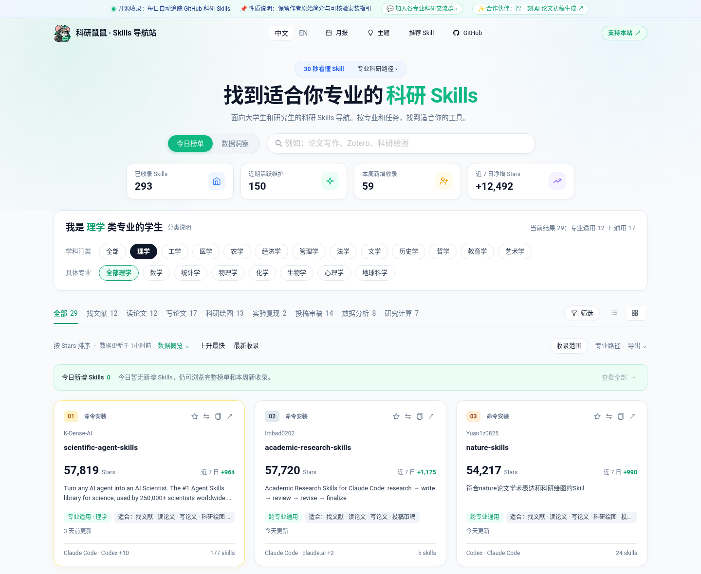

# Research Hamster · Skills Directory

**[简体中文 (README.md)](README.md)** · **English**

**Find open-source academic research Agent Skills on GitHub — organized by university discipline, research task, and AI Agent.**

**Research Hamster · Skills Directory** (`shushu-research-skills`), curated and maintained by RiceAI88, indexes open-source GitHub Agent Skills for literature search, paper reading, academic writing, publication figures, experiment reproduction, peer review, statistical/econometric analysis, and scientific computing. Filter across **12 academic disciplines**, **8 research tasks**, and **supported AI Agents** (Claude Code, Codex, Cursor, Antigravity, Gemini, MCP, and Web AI). Each entry pairs the repository author's original description with environment prerequisite tags, a 3-step quick-start guide, and maintenance health indicators.

### [Open English Research Skills Directory →](https://riceai985.cc/en/)

[By Discipline](#browse-by-discipline) · [By Task](#browse-by-research-task) · [How to Use](#how-to-use) · [New Today](#new-skills-today) · [Top Skills](#top-research-skills) · [Related Tools](#research-related-projects) · [Methodology](#collection--methodology) · [Submit a Repo](https://github.com/RiceAI88/shushu-research-skills/issues/new?template=recommend-repo.yml) · [简体中文](README.md)

*If this directory saves you time, please consider giving it a Star 🌟 or [recommending a repository](https://github.com/RiceAI88/shushu-research-skills/issues/new?template=recommend-repo.yml).*

## Browse by Discipline

Choose your academic division first, then narrow down by major and research task:

[Sciences](https://riceai985.cc/en/#discipline=science) · [Engineering](https://riceai985.cc/en/#discipline=engineering) · [Medicine](https://riceai985.cc/en/#discipline=medicine) · [Agriculture](https://riceai985.cc/en/#discipline=agriculture) · [Economics](https://riceai985.cc/en/#discipline=economics) · [Management](https://riceai985.cc/en/#discipline=management)

[Law & social studies](https://riceai985.cc/en/#discipline=law) · [Languages & literature](https://riceai985.cc/en/#discipline=literature) · [History](https://riceai985.cc/en/#discipline=history) · [Philosophy](https://riceai985.cc/en/#discipline=philosophy) · [Education](https://riceai985.cc/en/#discipline=education) · [Arts](https://riceai985.cc/en/#discipline=arts)

Discipline classifications are grounded in official repository documentation (160+ curated profiles and growing). Cross-discipline general research Skills and broader academic tools can be toggled inline via the scope selector.

## Browse by Research Task

| What do you want to accomplish? | Jump to |
|---|---|
| Search papers & verify citations | [Literature Search](https://riceai985.cc/en/#task=find) |
| Read, summarize, or translate papers | [Paper Reading](https://riceai985.cc/en/#task=read) |
| Structure manuscripts, polish academic prose, or edit LaTeX | [Academic Writing](https://riceai985.cc/en/#task=write) |
| Generate publication-grade plots, schematics & posters | [Figures & Plots](https://riceai985.cc/en/#task=figures) |
| Reproduce experiments, benchmarks & evaluations | [Reproducibility](https://riceai985.cc/en/#task=reproduce) |
| Prepare submissions, peer-review checks & rebuttals | [Submission & Review](https://riceai985.cc/en/#task=review) |
| Run statistical analysis, econometrics & qualitative coding | [Data Analysis](https://riceai985.cc/en/#task=analyze) |
| Numerical simulation, modeling & scientific computing | [Scientific Computing](https://riceai985.cc/en/#task=compute) |

By default, the directory lists repositories with verified `SKILL.md` evidence. Enable **"Include related tools"** in the toolbar to also browse standalone research workflows, utilities, and open textbooks.

## How to Use

- **New to Agent Skills?** Click **"Understand Skills in 30s"** on the hero banner to see how Skills work with CLI/IDE agents (Claude Code, Codex, Cursor, Antigravity) — plus a **zero-CLI fallback guide** for pasting `SKILL.md` rules directly into web chat apps (ChatGPT, Claude.ai, DeepSeek, Kimi).
- **6 High-Frequency Research Presets**: One-click scenario filters for *Undergraduate Thesis Starter*, *Proposal & Literature Review*, *Journal Figures & Flowcharts*, *Surveys & Econometrics*, *Group Meeting Slides & Posters*, and *Polishing & Rebuttal*.
- **10 Curated Discipline Workflows**: Step-by-step toolchains across STEM, Medicine, Economics/Law, and Humanities showing prerequisites and verified source links.
- **3-Step Quick-Start & Output Previews**: Open any repository drawer to view environment badges (Pure Markdown, Local Python, GPU, External API Key), Before/After deliverable previews, copyable install commands, and bilingual research prompts.
- **Built-in AI Skill Advisor**: Click the animated Research Hamster assistant in the bottom-right corner to ask for tailored tool recommendations in natural language.
- **Shareable Lab Packs & Open Data**: Bookmark favorites into a shareable `#pack=...` URL for labmates, explore live **Data Insights**, or subscribe via [RSS](feed.xml), [Monthly Reports](reports/), [JSON](data/rankings.json), and [CSV](data/rankings.csv).

## New Skills Today

New Skills **22** · Measured by the Beijing calendar day (`UTC+8`) of first inclusion in this directory (not repository creation date).

- **[RUC-NLPIR/Arbor](https://github.com/RUC-NLPIR/Arbor)** — A generalist autonomous research agent — runs experiments, researches, and iteratively op…
- **[NeuroAIHub/BrainPilot](https://github.com/NeuroAIHub/BrainPilot)** — BrainPilot: Automating Brain Discovery with Agentic Research
- **[yaojingang/GEOLab](https://github.com/yaojingang/GEOLab)** — GEO research library for papers, datasets, white papers, experiments, and high-quality ar…
- **[andrehuang/research-companion](https://github.com/andrehuang/research-companion)** — Strategic research thinking agents for Claude Code — idea evaluation, project triage, and…
- **[wooly99/geng-academic-fraud-detector](https://github.com/wooly99/geng-academic-fraud-detector)** — 耿同学skill，学术论文打假检测 agent skill，致敬耿同学讲故事

[View all daily arrivals on the web →](https://riceai985.cc/en/#today=skill) · Up to 5 entries are previewed here; baseline imports are excluded from daily arrivals.

## Top Research Skills

Verified Skills **451** · Related Academic Projects **234** · Pending Verification **2**

Last updated: **2026-11-23 14:36 UTC+8**. Below are the Top 20 verified Skills ranked by GitHub Stars (tie-broken by trend score and repository name). Star counts and 7-day deltas reflect community attention, not peer-reviewed quality or installation guarantees.

| # | Repository | Stars | 7d Growth | Supported AI Agents | Author Description |
|---:|---|---:|---:|---|---|
| 1 | [Imbad0202/academic-research-skills](https://github.com/Imbad0202/academic-research-skills) | 58,153 | +1,116 | Claude Code | Academic Research Skills for Claude Code: research → write → review → revise → finalize |
| 2 | [K-Dense-AI/scientific-agent-skills](https://github.com/K-Dense-AI/scientific-agent-skills) | 58,135 | +808 | Claude Code/Codex/Cursor/Antigravity | Turn any AI agent into an AI Scientist. The #1 Agent Skills library for science, used by… |
| 3 | [Yuan1z0825/nature-skills](https://github.com/Yuan1z0825/nature-skills) | 54,617 | +953 | Codex | 符合nature论文学术表达和科研绘图的Skill |
| 4 | [wanshuiyin/Auto-claude-code-research-in-sleep](https://github.com/wanshuiyin/Auto-claude-code-research-in-sleep) | 19,620 | +367 | Claude Code/Codex/MCP | ARIS ⚔️ (Auto-Research-In-Sleep) — Lightweight Markdown-only skills for autonomous ML res… |
| 5 | [Imbad0202/academic-research-skills-codex](https://github.com/Imbad0202/academic-research-skills-codex) | 14,929 | +326 | Codex | Codex-native Academic Research Skills suite for human-in-the-loop academic research workf… |
| 6 | [aiming-lab/AutoResearchClaw](https://github.com/aiming-lab/AutoResearchClaw) | 14,925 | +4 | Claude Code/Codex/OpenCode/Gemini | Fully autonomous & self-evolving research from idea to paper. Chat an Idea. Get a Paper. 🦞 |
| 7 | [Orchestra-Research/AI-Research-SKILLs](https://github.com/Orchestra-Research/AI-Research-SKILLs) | 14,754 | +181 | Claude Code/Codex/Gemini | Comprehensive open-source library of AI research and engineering skills for any AI model.… |
| 8 | [HKUSTDial/Supervisor-Skills](https://github.com/HKUSTDial/Supervisor-Skills) | 13,296 | +694 | Claude Code/Cursor/Codex | 将博导十年科研经验炼化为可直接调用的 AI 技能。从 Idea 构思到论文投稿，你的 AI 科研副导师。 |
| 9 | [ChenLiu-1996/figures4papers](https://github.com/ChenLiu-1996/figures4papers) | 12,404 | +540 | Cursor/Claude Code/Codex | My Python scripts to make high-quality figures for publications in top AI conferences and… |
| 10 | [Companion-Inc/feynman](https://github.com/Companion-Inc/feynman) | 10,148 | +3 | Codex/OpenCode/MCP | The open source AI research agent. |
| 11 | [isaac-sim/IsaacLab](https://github.com/isaac-sim/IsaacLab) | 8,705 | +8 | See repo docs | Unified framework for robot learning with multi-physics/renderer support |
| 12 | [Master-cai/Research-Paper-Writing-Skills](https://github.com/Master-cai/Research-Paper-Writing-Skills) | 8,501 | +137 | Claude Code/Codex/Gemini | Skill package for ML/CV/NLP paper writing, curated and adapted from Prof. Peng Sida's ope… |
| 13 | [ningzimu/codex-ppt-skill](https://github.com/ningzimu/codex-ppt-skill) | 8,109 | +22 | Claude Code/Codex | GPT-Image-2 PPT Generator Skill for Creating Image-Based PowerPoint Presentations in Code… |
| 14 | [dwzhu-pku/PaperBanana](https://github.com/dwzhu-pku/PaperBanana) | 7,678 | +30 | Gemini | PaperBanana: Automating Academic Illustration For AI Scientists |
| 15 | [ScrapeCreators/social-media-research-skills](https://github.com/ScrapeCreators/social-media-research-skills) | 7,058 | +532 | Claude Code/Codex/Cursor/Gemini/Windsurf/MCP | AI agent skills for social media research. Outlier posts, comment mining, competitor tear… |
| 16 | [Adkid-Zephyr/anti-defensive-writing-Skill](https://github.com/Adkid-Zephyr/anti-defensive-writing-Skill) | 7,047 | +674 | Claude Code/Cursor | 极致轻量｜阻止论文的防御性写作 \| Anti-defensive writing for academic papers — 学术写作原则 Skill + prompt pack… |
| 17 | [larashero3-dotcom/lieflat-charts](https://github.com/larashero3-dotcom/lieflat-charts) | 6,971 | +8 | Claude Code/Codex | Data visualization Skill for AI Agents, turning data into polished, interactive HTML char… |
| 18 | [jihe520/MathModelAgent](https://github.com/jihe520/MathModelAgent) | 6,403 | +64 | Claude Code/Codex | 🤖📐专为数学建模设计的 Agent & skills ,自动完成数学建模，生成一份完整的可以直接提交的论文。 An Agent Designed for Mathematical… |
| 19 | [WUBING2023/PaperSpine](https://github.com/WUBING2023/PaperSpine) | 6,384 | +75 | Codex | Open-source AI for Science Skill for research agents. Review literature, run analyses, ma… |
| 20 | [zLanqing/codex-claude-academic-skills](https://github.com/zLanqing/codex-claude-academic-skills) | 6,187 | +194 | Claude Code/Codex | 本仓库包含三个面向学术科研人员的Skills，覆盖从文献阅读、论文写作到科学计算的完整研究工作流。office-academic-skill 负责论文阅读报告与学术 PPT/Wo… |

[Browse the full interactive ranking →](https://riceai985.cc/en/) · Descriptions preserve each author's original summary; see [Methodology](docs/methodology.md) for scoring details.

## Research-Related Projects

Top 10 standalone academic tools, frameworks, and learning resources (tracked separately from `SKILL.md` repositories):

| # | Repository | Stars | 7d Growth | Supported AI Agents | Author Description |
|---:|---|---:|---:|---|---|
| 1 | [binary-husky/gpt_academic](https://github.com/binary-husky/gpt_academic) | 71,711 | +46 | See repo docs | 为GPT/GLM等LLM大语言模型提供实用化交互接口，特别优化论文阅读/润色/写作体验，模块化设计，支持自定义快捷按钮&函数插件，支持Python和C++等项目剖析&自译解功能，… |
| 2 | [scutan90/DeepLearning-500-questions](https://github.com/scutan90/DeepLearning-500-questions) | 57,730 | +2 | See repo docs | 深度学习500问，以问答形式对常用的概率知识、线性代数、机器学习、深度学习、计算机视觉等热点问题进行阐述，以帮助自己及有需要的读者。 全书分为18个章节，50余万字。由于水平有限… |
| 3 | [PDFMathTranslate/PDFMathTranslate](https://github.com/PDFMathTranslate/PDFMathTranslate) | 38,600 | +15 | MCP | [EMNLP 2025 Demo] PDF scientific paper translation with preserved formats - 基于 AI 完整保留排版的… |
| 4 | [Leey21/awesome-ai-research-writing](https://github.com/Leey21/awesome-ai-research-writing) | 36,252 | +25 | See repo docs | Elevate your AI research writing, no more tedious polishing ✨ |
| 5 | [mli/paper-reading](https://github.com/mli/paper-reading) | 34,144 | +26 | See repo docs | 深度学习经典、新论文逐段精读 |
| 6 | [AccumulateMore/CV](https://github.com/AccumulateMore/CV) | 24,334 | +46 | See repo docs | ✅（已完结）超级全面的 深度学习 笔记【土堆 Pytorch】【李沐 动手学深度学习】【吴恩达 深度学习】【大飞 大模型Agent】 |
| 7 | [amusi/CVPR2026-Papers-with-Code](https://github.com/amusi/CVPR2026-Papers-with-Code) | 22,967 | +10 | See repo docs | CVPR 2026 论文和开源项目合集 |
| 8 | [kaixindelele/ChatPaper](https://github.com/kaixindelele/ChatPaper) | 20,021 | +4 | See repo docs | Use ChatGPT to summarize the arXiv papers. 全流程加速科研，利用chatgpt进行论文全文总结+专业翻译+润色+审稿+审稿回复 |
| 9 | [immersive-translate/immersive-translate](https://github.com/immersive-translate/immersive-translate) | 19,869 | +5 | See repo docs | 沉浸式双语网页翻译扩展 , 支持输入框翻译， 鼠标悬停翻译， PDF, Epub, 字幕文件, TXT 文件翻译 - Immersive Dual Web Page Transl… |
| 10 | [ZJU-LLMs/Foundations-of-LLMs](https://github.com/ZJU-LLMs/Foundations-of-LLMs) | 18,632 | — | See repo docs | A book for Learning the Foundations of LLMs |

[Browse with related projects enabled →](https://riceai985.cc/en/#related=1)

## Collection & Methodology

- **Discovery & Verification**: Public GitHub API queries across popular, recently updated, and star-banded repositories, combined with maintainer/community submissions. Candidates must meet the **30-star** threshold, show explicit academic/scientific intent in README documentation, and pass mirror/clone deduplication.
- **Two-Track Classification**: Default-branch trees are inspected for `SKILL.md` definitions to separate native Agent Skills from general academic tools. Transient API failures preserve previously verified entries in a pending state rather than dropping them.
- **Daily Schedule**: [Update rankings](https://github.com/RiceAI88/shushu-research-skills/actions/workflows/update-rankings.yml) runs daily around **02:00 UTC (10:00 UTC+8)** and regenerates both [`README.md`](README.md) and [`README_EN.md`](README_EN.md) via `render_readme` / `render_readme_en` in [`scripts/update_rankings.py`](scripts/update_rankings.py). See [Collection Report](data/collection-report.json) and [Collection Events](data/collection-events.json) for audit logs.

## Contributing

Found a missing research Skill or an inaccurate discipline tag? [Open a Recommendation Issue](https://github.com/RiceAI88/shushu-research-skills/issues/new?template=recommend-repo.yml) or read [`CONTRIBUTING.md`](CONTRIBUTING.md).

## Credits & License

Originally seeded from [kael-odin/awesome-academic-research-skills](https://github.com/kael-odin/awesome-academic-research-skills) with gratitude to [kael-odin](https://github.com/kael-odin), and independently rebuilt and maintained by RiceAI88 with React interactive filtering, discipline taxonomy, 3-step onboarding guides, two-track verification, and automated daily snapshots.

Released under the [MIT License](LICENSE).
